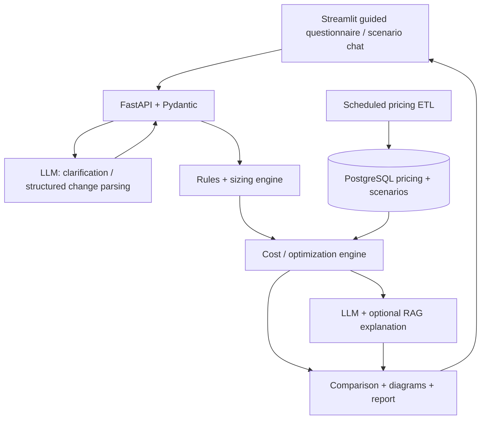

# ArchWise AI — Product Requirements Document

**Project:** ArchWise AI — Cost, Performance & Future-Ready Cloud Architecture Advisor  
**Document type:** Product and Technical Requirements (PRD)  
**Version:** 1.1  
**Status:** MVP scope decided (see §0 Decision Log)  
**Last updated:** 2026-11-20

## 0. Decision Log (v1.1)

Decisions made on 2026-11-20 that resolve conflicts between v1.0 of this document and the
existing prototype. Where a later section disagrees with this table, this table wins.

| ID | Decision | Rationale |
| --- | --- | --- |
| D-01 | **First workload class: REST API / e-commerce** (request-driven web applications). Event-driven processing moves to Phase 2. | The prototype engine already models request-driven workloads, and the unknown-traffic scenarios are expressed in requests/day. Event-driven processing needs new modeling (queues, ordering, retention, replay). |
| D-02 | **AWS is the reference provider with sourced prices** from the pricing ETL. GCP and Azure stay in the comparison using the prototype's **approximate static catalog**, clearly labeled "approximate — not sourced". | Keeps the ETL scope narrow (AWS first, per ETL-10) without discarding working multi-cloud comparison. Provenance rules (FR-17, FR-20) make the difference visible. |
| D-03 | **UI: FastAPI + Streamlit for the MVP**; React + TypeScript deferred to Phase 3. | FastAPI separates the engine from the UI now; Streamlit keeps the first release achievable alongside the ETL. |
| D-04 | **Unknown-traffic scenarios: Low 1,000 / Medium 100,000 / High 1,000,000 requests per day.** Values are configurable. | Illustrative modeling assumptions, never predictions (FR-21). |
| D-05 | **Baseline region: AWS us-east-1.** Regional selection is added after the ETL works for one region. | Matches ETL-10's narrow-first approach. |
| D-06 | **Delivery: runs locally; source published on GitHub.** No hosted public demo in the MVP. | Resolves open question 6; avoids hosted-inference cost and abuse risk. |
| D-07 | **Local LLM: Ollama + Qwen 3.5 (9B default, 4B for machines with ≤8 GB free RAM).** Hosted options (Hugging Face, OpenAI, Gemini, Claude) via user-supplied keys; template fallback always available. | Already implemented in the prototype provider layer. |

### 0.1 Problem Statement

> Cloud architecture decisions are expensive, complex, and difficult to validate. Organizations
> need a way to compare infrastructure options against current costs, performance requirements,
> operational overhead, and future growth without repeatedly redesigning their systems.

### 0.2 Prototype Status (what already exists)

A working prototype (v0) predates this document. It provides: a deterministic engine evaluating
four patterns (serverless, managed containers, Kubernetes, VMs) on AWS, GCP and Azure; sizing,
SLA composition, latency estimation, HA → multi-region escalation and ranking; Mermaid diagrams;
a Streamlit UI; the multi-provider LLM layer (D-07) with structured extraction and a numeric
guardrail; and 51 automated tests. MVP work **extends** this prototype rather than replacing it.

## 1. Executive Summary

ArchWise AI is an **AI-assisted, constraint-aware cloud architecture evaluation platform**. It helps startup teams, solution architects, consultants, and engineering teams compare cloud service combinations against **budget, latency, availability, operational overhead, scalability, and future growth**.

The product is **not** intended to be a chatbot that invents a cloud architecture. Its core is a **deterministic Python rules, sizing, pricing, and optimization engine**. An open-weight large language model (LLM) helps interpret requirements, ask clarifying questions, explain validated alternatives, and translate follow-up requests into structured scenario changes.

ArchWise AI's core question is:

> **If we choose this cloud architecture today, what will it cost, will it meet our requirements, and what happens when our workload grows?**

## 2. Business Problem

Cloud architecture decisions are expensive and difficult to validate. Organizations often lack the time or specialized expertise needed to:

- Select a compatible combination of cloud services rather than one isolated product.
- Balance monthly infrastructure expense with latency, reliability, scalability, and operational burden.
- Understand future costs and potential redesign triggers when workloads grow.
- Produce repeatable, evidence-backed comparisons instead of relying on ad hoc chatbot answers or static calculators.
- Update an architecture recommendation when requirements change without restarting the whole planning process.

A low-cost architecture today can create higher total costs later through outages, operational toil, or costly migrations. Conversely, overprovisioning for speculative growth can waste budget.

### 2.1 Value Proposition

**ArchWise AI makes cloud architecture planning reproducible and evidence-backed.** It compares feasible designs, estimates total cost of ownership across scenarios, surfaces trade-offs and uncertainty, and gives teams a decision record they can revisit as requirements change.

### 2.2 Differentiation from General-Purpose LLM Chat

General-purpose LLMs can suggest designs and discuss cloud services. ArchWise AI aims to provide an integrated workflow with:

1. Guided, structured requirements and explicit assumptions.
2. Deterministic feasibility rules and repeatable architecture ranking.
3. A source-traceable cloud-pricing catalog maintained by an ETL pipeline.
4. Itemized current and projected costs with transparent usage assumptions.
5. Side-by-side alternatives and what-if recalculation.
6. Diagrams generated from validated architecture specifications.
7. Explicit distinctions among calculated, modeled, benchmarked, and unverified claims.

**Important:** The product is an architecture **decision-support** tool, not a substitute for production load testing, security review, detailed design, or provider-specific deployment validation.

## 3. Target Users and Use Cases

### 3.1 Primary MVP Audience

- Startups and small engineering teams planning new web/API applications (AWS as the reference provider).
- Cloud consultants and solution architects preparing multiple client proposals.

### 3.2 Secondary Audience (Later Phases)

- Teams optimizing existing AWS or GCP infrastructure.
- Organizations planning cloud migration or modernization.
- Engineering managers evaluating long-term infrastructure investment.

### 3.3 Primary Use Cases

| ID | Use case | Expected outcome |
| --- | --- | --- |
| UC-01 | New application with known workload | Compare feasible architectures and costs using measured traffic and requirements. |
| UC-02 | New application with unknown workload | Evaluate disclosed low/medium/high traffic scenarios without pretending to know demand. |
| UC-03 | Fixed cloud-provider requirement | Compare compatible combinations within the selected provider (e.g., AWS only). |
| UC-04 | Cost, performance, and operations trade-offs | Show cheapest, simplest-to-operate, and most-scalable qualifying designs. |
| UC-05 | Traffic spike or future growth | Rerun the engine for revised demand and show cost, scaling, and redesign implications. |
| UC-06 | Changed availability or budget | Recalculate feasible choices; flag constraints that cannot be satisfied. |
| UC-07 | Technical follow-up | Answer questions such as “Why not Kubernetes?” with cited explanations and validated scenarios where appropriate. |
| UC-08 (Later) | Existing infrastructure optimization | Analyze usage and current architecture to evaluate right-sizing and migration options. |
| UC-09 (Later) | Cloud migration / modernization | Compare potential target architectures and risks before detailed migration planning. |

## 4. Product Principles and Non-Goals

### 4.1 Principles

- **Deterministic decisions:** Code owns candidate feasibility, sizing, pricing math, hard constraints, and rankings.
- **AI-assisted interaction:** LLM owns interpretation, clarification, explanations, and structured suggestions for re-evaluation.
- **Evidence over confidence:** Show sources and confidence/verification status; do not promise unsupported latency or savings.
- **No silent assumptions:** Clearly label missing inputs and default scenario assumptions.
- **Cloud-provider constraint first:** Never recommend outside a user-mandated provider unless explicitly exploring a change.
- **Multi-objective:** Evaluate infrastructure cost, operational cost, performance, reliability, scaling, and future re-engineering risk together.
- **Reproducibility:** Preserve input version, rules version, prices, generated candidates, and outputs.
- **Focused MVP:** Demonstrate accuracy in a narrow workload domain before adding broad catalogs.

### 4.2 Explicit Non-Goals for MVP

- No autonomous multi-agent architecture; **agents are not required**.
- No automatic creation, modification, or deletion of production cloud resources.
- No guarantee of real-world p95 latency without benchmarks or load tests.
- No claim of exact future cloud bills or re-engineering costs.
- No full ingestion of every SKU from every provider.
- No complete enterprise governance, compliance certification, or mainframe migration automation.
- No requirement for users to provide production credentials or sensitive application data.

## 5. User Journey

1. Guided questionnaire starts with what users usually know (§6.1.1): application type, cloud
   preference, budget, response-time class, downtime tolerance, growth pattern, team size.
2. User either enters traffic figures (**Known Workload**) or selects **"I don't know my expected
   traffic"** (**Unknown Workload**), which triggers scenario evaluation (§6.4).
3. If data is vague, contradictory, or decision-critical, LLM asks **one to three targeted clarification questions**.
4. The system displays confirmed requirements, inferred fields, defaults, and unresolved uncertainties for review.
5. Python engine generates candidate architectures from a controlled service catalog and evaluates hard constraints.
6. Pricing engine calculates cost breakdowns and ranges, using a versioned, normalized pricing catalog.
7. Engine ranks candidates under different objectives and produces **two or three distinct options** where feasible.
8. LLM explains why each option fits or fails the stated priorities and cites relevant documentation.
9. UI displays diagrams, cost breakdowns, trade-offs, performance-evidence status, and growth scenarios.
10. User changes requirements or asks a follow-up; backend stores a revised scenario, reruns the engine, and shows the differences.
11. User can export or share a reproducible decision report (later in MVP or Phase 2).

## 6. Functional Requirements

### 6.1 Requirements Intake

| ID | Requirement | Priority | Acceptance criteria |
| --- | --- | --- | --- |
| FR-01 | Guided questionnaire instead of a mandatory free-text prompt. | Must | Form captures application/workload type, cloud preference, budget, traffic, data profile, team size, latency, availability, and growth expectations. |
| FR-02 | Two workload modes: known and unknown traffic. | Must | Users can explicitly choose “I don't know my traffic”; system does not silently substitute one exact prediction. |
| FR-03 | Structured input validation. | Must | Reject invalid units, negative values, and contradictory hard constraints; allow incomplete drafts. |
| FR-04 | Plain-English description as optional input. | Should | LLM extracts fields into a typed schema and marks inferred versus explicitly supplied values. |
| FR-05 | Targeted clarifications. | Should | Ask 1–3 high-impact questions when ambiguity changes sizing or feasibility; do not ask irrelevant questions. |
| FR-06 | Distinguish constraints from preferences. | Must | Hard constraints (e.g., provider, max budget, residency) are never silently relaxed; optimization priorities can be weighted. |
| FR-07 | Clarify data sensitivity and region where relevant. | Should | User can specify deployment region and constraints such as residency or private networking. |

#### 6.1.1 Known-First Intake

The questionnaire starts with information customers are likely to know, then offers
**"I don't know my expected traffic."** Every qualitative answer maps to engine inputs that are
displayed as **defaults** and remain editable.

| Question | Answer options | Engine mapping (default, editable) |
| --- | --- | --- |
| Application type | **E-commerce, REST API** (MVP); data pipeline, document processing, event-driven (later) | Selects a **workload template** (§6.4.1) |
| Cloud preference | AWS, GCP, Azure, no preference | Hard constraint if a provider is required (FR-06) |
| Monthly budget | e.g. $500 / $1,000 / $5,000 / custom | Hard limit or preference — user chooses |
| Response time needed | Milliseconds / Seconds / Minutes | p95 ≤ 300 ms / ≤ 5 s / asynchronous processing acceptable |
| Downtime tolerance | Occasional downtime OK / Rarely / Never | 99.5% / 99.9% / 99.95%+ availability target |
| Expected growth | New startup / Steady growth / Unpredictable seasonal spikes | Growth rate and peak-to-average spike factor (§6.4.2) |
| Team size | Engineers available to maintain infrastructure | Operations capacity (none / low / medium / high) |

"Minutes" is significant: it permits queue- or batch-based designs, which are modeled once
event-driven workloads arrive (Phase 2). In the MVP it relaxes the latency target and is noted
as a candidate for asynchronous design.

#### Minimum Input Fields

| Category | Fields |
| --- | --- |
| Workload | Application type: **REST API or e-commerce in the MVP**; event-driven processing and batch ETL in later phases. |
| Traffic | Average/peak requests per second or daily volume; unknown option; burst duration; growth scenarios. |
| Data | Storage size and growth, event/data volume, transactional/streaming/batch/unstructured characteristics, retention. |
| Performance | Response or processing latency target, e.g., p95 latency or end-to-end processing delay. |
| Reliability | Availability target, tolerated downtime, recovery time objective (RTO), recovery point objective (RPO) where needed. |
| Budget | Monthly infrastructure budget, currency, and whether operations cost is included. |
| Operations | Team size, maintenance tolerance, managed-service preference. |
| Cloud | Required or preferred provider, region, service restrictions. |
| Horizon | Present usage and optional 12-month growth assumptions. |

### 6.2 Candidate Generation and Constraints

| ID | Requirement | Priority | Acceptance criteria |
| --- | --- | --- | --- |
| FR-08 | Generate candidate combinations from a maintained service catalog. | Must | All candidates contain known, compatible service roles and valid supported configurations. |
| FR-09 | Deterministically evaluate hard constraints. | Must | Every candidate has explicit pass/fail reasons and blocked candidates are not labeled viable. |
| FR-10 | Estimate capacity and scaling assumptions. | Must | Size assumptions are transparent and traceable; missing benchmarks remain flagged. |
| FR-11 | Rank candidates by cost, operations, scalability, and reliability. | Must | Ranking results are repeatable for the same inputs, rules version, and pricing snapshot. |
| FR-12 | Expose conflicts and infeasible scenarios. | Must | If no architecture satisfies the constraints, return reasons and possible changes rather than inventing a winner. |
| FR-13 | Permit LLM-suggested experiments only as structured requests. | Should | Engine validates any proposed service or constraint modification before calculation. |

### 6.3 Architecture Comparison and Costing

| ID | Requirement | Priority | Acceptance criteria |
| --- | --- | --- | --- |
| FR-14 | Compare 2–3 distinct feasible candidates. | Must | Show “lowest estimated cost”, “lowest operational effort”, and “most scalable” when distinct qualifying choices exist. When traffic is unknown, also show **“most robust across scenarios”** (§6.4.3). “Most scalable” is measured as the highest traffic tier the option supports without a redesign trigger. |
| FR-15 | Itemized monthly estimates. | Must | Compute, storage, database, requests, networking, and applicable service charges are displayed with units and assumptions. |
| FR-16 | Cost ranges / sensitivity. | Must | Show low/base/high or min/max scenarios and indicate uncertainty from assumed workload. |
| FR-17 | Pricing provenance. | Must | Every priced line item is linked to provider, SKU/rate, region, effective/retrieved timestamp, and pricing snapshot. Line items from the static approximate catalog (GCP and Azure in the MVP, per D-02) are labeled **“approximate — not sourced”** and their totals are never described as current or verified. |
| FR-18 | Total cost of ownership view. | Should | Model infrastructure, operational effort, and potential migration/re-engineering scenario costs separately. |
| FR-19 | Priority-aware trade-offs. | Must | Explanations explicitly tie gains/losses to user priorities and hard constraints. |
| FR-20 | Pricing freshness guardrails. | Must | Missing, incompatible, stale, or ambiguous prices are surfaced; totals are not described as verified in those cases. |

### 6.4 Unknown-Traffic and Growth Modeling

| ID | Requirement | Priority | Acceptance criteria |
| --- | --- | --- | --- |
| FR-21 | Low/medium/high traffic scenario evaluation. | Must | Scenarios display assumptions, estimated spend, and likely scaling considerations without implying demand forecasts. |
| FR-22 | Autoscaling evaluation. | Must | Assess service quotas, concurrency, database connections, cold starts/scale-up, and other bottlenecks when applicable. |
| FR-23 | Growth what-if simulation. | Should | Recalculate when traffic, spike duration, latency, team size, budget, or availability changes. |
| FR-24 | Architecture evolution view. | Should | Show likely resize/reconfigure/redesign triggers under selected growth scenarios and label speculation. |
| FR-25 | Twelve-month planning horizon. | Should | Compare scenario-based monthly spend and likely adaptation points over 12 months; no unsupported forecasts. |
| FR-25a | Budget-based capacity. | Must | For each feasible option, report the highest daily traffic it supports within the user's budget (“with $500/month, Option A supports up to ~N requests/day”). |
| FR-25b | Robust recommendation under unknown traffic. | Should | Identify the option with the smallest worst-case regret across Low/Medium/High (§6.4.3). |

#### 6.4.1 Workload Templates

Daily volume alone cannot size an architecture. Each application type supplies a template of
per-request assumptions, shown as **defaults** and editable:

| Template | Unit of traffic | Default assumptions (illustrative) |
| --- | --- | --- |
| REST API | requests/day | ~120 ms compute per request, 512 MB worker memory, 2 DB queries per request, 20% writes, small payloads |
| E-commerce | requests/day | ~150 ms compute, 3 DB queries per request, relational database, product images in object storage served via CDN, higher peak factor around sales events |

Later templates use their own units: documents/day (document processing), GB or events/day
(data pipelines, event-driven).

#### 6.4.2 Scenario Definition

| Scenario | Illustrative traffic assumption | Average rate |
| --- | --- | --- |
| Low | 1,000 requests/day | ~0.01 requests/s |
| Medium | 100,000 requests/day | ~1.2 requests/s |
| High | 1,000,000 requests/day | ~11.6 requests/s |

- These are **example modeling assumptions, not predictions** of the customer's usage, and the UI
  says so wherever scenario results appear.
- Peak traffic = average × a spike factor derived from the growth answer (e.g. steady ≈ 3×,
  seasonal spikes ≈ 10×), displayed as an assumption.
- Tier values are configuration, not code, so they can be changed without a release.
- Note: at these volumes, absolute cost differences between designs are modest; the comparison
  emphasizes cost **trend**, feasibility, and operational effort across tiers.

#### 6.4.3 Scenario Outputs

For each candidate architecture and each scenario the engine reports: feasibility (with reasons),
itemized monthly cost, and triggered limits. The comparison view then shows:

1. **Cost range** per option (Low → High) rather than a single figure.
2. **Crossover points**: where the cheapest option changes as traffic grows.
3. **Redesign triggers**: the first tier at which an option fails a hard limit
   (e.g. database capacity, concurrency quota).
4. **Budget capacity** (FR-25a).
5. **Most robust option**: for each scenario, regret = option cost − cheapest feasible cost in that
   scenario (infeasible = unbounded); the robust option minimizes the maximum regret.

### 6.5 LLM Assistance and Follow-up Chat

| ID | Requirement | Priority | Acceptance criteria |
| --- | --- | --- | --- |
| FR-26 | Open-weight model used for explanations and interaction. | Must | Local default uses **Ollama + compatible Qwen instruct model**. |
| FR-27 | Provider abstraction. | Should | Same typed interface supports an optional hosted provider through Hugging Face Inference Providers. |
| FR-28 | Deterministic no-LLM fallback. | Must | The app still returns comparisons, prices, pass/fail results, and basic template explanations if LLM is unavailable. |
| FR-29 | Typed LLM output. | Must | All extracted requirements and change requests pass Pydantic validation before use. |
| FR-30 | Grounded explanations. | Must | LLM only describes the engine's calculations and documented assumptions; unsupported numbers are blocked or flagged. |
| FR-31 | Follow-up chat with structured scenario updates. | Should | “Traffic triples” changes the relevant field, keeps others unchanged, persists a new version, and reruns the engine. |
| FR-32 | What-if suggestions. | Should | LLM can suggest relaxing a constraint or adding a service, but never claims a benefit before engine verification. |
| FR-33 | Documentation retrieval. | Should | RAG retrieves relevant provider documentation with source links and publication/retrieval metadata where available. |
| FR-34 | Fail safely on contradictions or unsupported requests. | Must | Do not silently guess if uncertainty is decision-critical. Ask for clarification or mark results provisional. |

**LLM boundary:** The LLM does **not** own prices, numeric calculations, hard-constraint decisions, feasibility flags, or final rankings. It may propose tests, but the engine decides whether they are valid and computes the result. Model-generated numbers must be checked against approved output fields, with tolerances for formatting/rounding only.

### 6.6 Visualization and Reporting

| ID | Requirement | Priority | Acceptance criteria |
| --- | --- | --- | --- |
| FR-35 | Architecture diagram generated from validated JSON. | Must | Diagram displays actual selected services and their connections; Mermaid used in MVP. |
| FR-36 | Side-by-side comparison view. | Must | Shows price range, major services, trade-offs, constraint status, and evidence status for each option. |
| FR-37 | Scenario diff. | Should | Users can compare before/after requirements, architecture components, costs, and risks. |
| FR-38 | Decision report export. | Could | Produce a shareable Markdown/PDF report with assumptions, prices, dates, diagrams, and recommendations. |
| FR-39 | Traceability. | Must | Save versions of requirements, prices, engine rules, candidate architectures, and final explanations. |

## 7. Cloud Pricing ETL Pipeline

### 7.1 Objective

Maintain a **normalized, versioned PostgreSQL catalog of public cloud prices** so the pricing engine calculates costs from sourced rates rather than LLM guesses.

### 7.2 Sources

- **AWS:** Official AWS Price List / pricing data APIs, using available authenticated or public endpoints as appropriate.
- **GCP (Phase 3):** Google Cloud Billing Catalog pricing APIs. Until then, the approximate static catalog (D-02).
- **Azure (Phase 3):** Azure Retail Prices API. Until then, the approximate static catalog (D-02).

MVP ingests **a curated subset of AWS services in us-east-1** (D-05) needed by the REST API and
e-commerce templates; it does not ingest the entire global catalog.

**Proposed MVP AWS SKU scope** (to confirm — open question 3): Lambda (requests, GB-seconds,
provisioned concurrency), API Gateway HTTP API (requests), ECS on Fargate (vCPU-hour, GB-hour),
Application Load Balancer (hour, LCU-hour), EKS (cluster-hour), EC2 on-demand for the instance
types the engine uses, RDS for PostgreSQL (instance-hours single/Multi-AZ, storage GB-month),
RDS Proxy, DynamoDB on-demand (read/write request units, storage), ElastiCache (node-hour),
S3 Standard (GB-month), CloudFront and internet data transfer out (GB).

### 7.3 Pipeline


### 7.4 Pipeline Requirements

| ID | Requirement | Priority |
| --- | --- | --- |
| ETL-01 | Scheduled refresh with configurable cadence (initially daily for supported catalog). | Must |
| ETL-02 | Retry/backoff, pagination, rate-limit handling, and incremental fetching where supported. | Must |
| ETL-03 | Preserve raw source payloads and ingestion timestamps for audit/debugging. | Must |
| ETL-04 | Normalize provider, service, SKU, region, purchase model, unit, currency, tier start/end, rate, effective time, and attributes. | Must |
| ETL-05 | Use exact decimal types for monetary data; do not represent rates as binary floating point. | Must |
| ETL-06 | Idempotent loads with stable source keys and atomic publication of validated snapshots. | Must |
| ETL-07 | Record job status, timestamps, counts, source version and failure reasons in a sync-run table. | Must |
| ETL-08 | Validate anomalies: missing regions, unsupported billing units, negative prices, duplicate keys, abrupt rate changes. | Must |
| ETL-09 | Expose catalog freshness and rate lineage to every architecture estimate. | Must |
| ETL-10 | Add GCP/Azure adapters only after AWS catalog is working and tested. | Should |

### 7.5 Suggested Logical Data Model

- `pricing_sync_runs`: run ID, provider, start/end, status, source metadata, row counts, error details.
- `pricing_raw_snapshots`: provider, source URI/identifier, payload location/JSON, fetched time, checksum.
- `cloud_pricing_rates`: provider, service, SKU, region, purchase model, billing unit, tier boundaries, decimal rate, currency, effective time, source/snapshot reference, flexible attributes.
- `architecture_scenarios`: user-confirmed requirements, assumptions, scenario/version ID, rules version, pricing snapshot ID.
- `architecture_candidates`: service graph, feasibility checks, size and cost breakdown, ranks, explanation references.

**Pricing caveats:** Account-specific discounts, private contract pricing, taxes, credits, free tiers, reservations, currency conversion, network egress, and tier applicability require explicit modeling or exclusion notices. Public prices are estimates, not a customer's guaranteed bill.

## 8. Architecture and Technical Stack

### 8.1 Suggested Stack

| Layer | Technology | Role |
| --- | --- | --- |
| Frontend | **Streamlit (MVP, D-03)**; React + TypeScript in Phase 3 | Guided form, candidate comparison, scenario editor, chat, diagram renderer. |
| API | FastAPI | Requests, scenarios, evaluations, reporting, LLM adapter. |
| Validation | Pydantic | Typed requirements, scenario changes, LLM outputs. |
| Decision / sizing / optimization | Python | Compatible candidates, hard constraints, scoring, capacity assumptions. |
| Pricing ingestion | Python scheduled ETL; Airflow optional | Fetch and normalize provider prices into PostgreSQL. |
| Database | PostgreSQL | Pricing, runs, requirements, scenarios, outputs and audit trail. |
| Retrieval (Phase 2) | pgvector + embeddings | Provider documentation retrieval for evidence-backed explanations. |
| LLM (local) | Ollama + Qwen 3.5 (9B / 4B) | Clarification, explanation, follow-up interpretation. |
| LLM (hosted option) | Hugging Face, OpenAI, Gemini, Claude (user-supplied keys) | Optional hosted inference via one provider interface. |
| LLM unavailable | Templates | Deterministic explanations of engine results. |
| Diagrams | Mermaid | Render from validated service graph, not unvalidated generated syntax. |
| Dev / quality | Docker Compose, pytest, GitHub Actions | Reproducible local development and CI. |

**No autonomous agents required.** For MVP, implement an explicit, testable Python workflow with direct LLM calls. LangGraph may be added only if the conversation/step orchestration becomes complex enough to justify it.

### 8.2 High-Level Flow



### 8.3 Example Scenario State

```json
{
  "cloud_provider": "aws",
  "workload_type": "ecommerce",
  "traffic_mode": "unknown",
  "traffic_scenarios_requests_per_day": {"low": 1000, "medium": 100000, "high": 1000000},
  "region": "us-east-1",
  "monthly_budget_usd": 1000,
  "budget_is_hard_limit": true,
  "response_time_class": "milliseconds",
  "downtime_tolerance": "rarely",
  "growth_pattern": "seasonal_spikes",
  "availability_target_percent": 99.9,
  "team_size": 2,
  "priority_weights": {
    "cost": 0.4,
    "operations": 0.3,
    "performance": 0.2,
    "scalability": 0.1
  },
  "field_provenance": {"monthly_budget_usd": "stated", "p95_latency_ms": "default"}
}
```

**Note:** Priority weights are illustrative and configurable; they do not override hard constraints. In practice, the application must confirm template assumptions (compute per request, database queries, payload size, peak factor) before treating its estimate as complete.

## 9. Evaluation and Ranking Rules

1. **Generate:** Select candidate templates and configurations from supported service catalog.
2. **Validate:** Reject incompatible services and violations of hard constraints.
3. **Size:** Estimate capacity requirements based on workload assumptions and service limits.
4. **Price:** Use the selected validated pricing snapshot to calculate an itemized cost range.
5. **Assess:** Evaluate operational complexity, scaling characteristics, failure modes, and performance evidence.
6. **Rank:** Produce objective-specific rankings only among feasible candidates.
7. **Explain:** Use LLM or fallback templates to articulate user-specific benefits and sacrifices.
8. **Re-evaluate:** On a changed requirement, preserve original scenario and compute a new version.

**Do not present a scored performance estimate as a guaranteed p95 latency.** If insufficient workload/benchmark data is available, label the target **unverified / requires load testing**.

### 9.1 TCO / Future-Cost Modeling

Track at minimum:

- Infrastructure usage cost (calculated from modeled consumption and applicable prices).
- Operational effort assumptions (estimated engineering hours and hourly cost where provided).
- Growth scenario costs for near-term and 12-month horizon.
- Potential redesign/migration triggers and estimated effort ranges, clearly marked as assumptions.

An illustrative total is:

`Scenario TCO = projected infrastructure cost + assumed operations cost + scenario-dependent migration/re-engineering cost`

Do not assume future migration cost is knowable or that every architecture will require a redesign.

## 10. Nonfunctional Requirements

| ID | Area | Requirement |
| --- | --- | --- |
| NFR-01 | Correctness | Identical inputs, rule versions, and price snapshots yield identical deterministic results. |
| NFR-02 | Testability | Unit tests for rules, conversions, tiers, edge cases, and scenario mutations. |
| NFR-03 | Explainability | Every major decision includes constraint outcome, assumptions, and evidence source. |
| NFR-04 | Security | No cloud production credentials in MVP; validate inputs, avoid storing secrets, and restrict external URLs. |
| NFR-05 | Reliability | If LLM fails, non-AI architecture evaluation and template explanations remain available. |
| NFR-06 | Observability | Structured logs, ETL run metrics, rule-evaluation traces, LLM failures, and latency measurements. |
| NFR-07 | Performance | Set measurable API/evaluation time targets after a baseline prototype and profile costly evaluations separately. |
| NFR-08 | Cost control | Cache reusable docs and pricing; enforce model timeouts, concurrency limits, and token budgets. |
| NFR-09 | Maintainability | Cloud provider adapters, cost calculators, service catalogs, and LLM adapters are separate modules. |
| NFR-10 | Privacy | Minimize user data; show which information is sent to any hosted inference provider; avoid proprietary client logs by default. |
| NFR-11 | Usability | User can get provisional results without knowing detailed requests/second, but all estimates disclose assumptions. |

## 11. MVP Scope and Phases

### Phase 1 — Deterministic Advisor with Sourced AWS Pricing (First GitHub Release)

**In scope:**

- Known-first guided intake (§6.1.1) with the **"I don't know my expected traffic"** option.
- **REST API and e-commerce** workload templates (D-01).
- Unknown-traffic evaluation across Low / Medium / High (D-04): cost ranges, crossover points,
  redesign triggers, budget capacity, most-robust option.
- AWS pricing ETL for **us-east-1** (D-05) into PostgreSQL with scheduled refresh, provenance,
  validation, and a sync-run log; the engine reads AWS prices from the published snapshot.
- GCP and Azure comparison retained on the approximate catalog, labeled per FR-17 (D-02).
- FastAPI service in front of the engine; Streamlit UI calling it (D-03).
- Evidence labels on every check: calculated, provider-published, estimated / requires load testing.
- Hard constraints vs preferences and explicit conflict reporting (FR-06, FR-12).
- Ollama + Qwen explanations tied to user priorities, numeric guardrail, template fallback (D-07).
- Mermaid diagrams, Docker Compose, tests, README, sample scenarios, CI.

**MVP demonstration:** A user who doesn't know their traffic picks *E-commerce*, *AWS*,
*$1,000/month*, *milliseconds*, *rarely down*, *seasonal spikes*, *2 engineers*. ArchWise shows,
for each candidate and each scenario, sourced AWS costs, feasibility, the traffic level at which
each option needs redesign, how much traffic $1,000 supports, and which option is most robust —
with an AI explanation that contains no AI-generated numbers.

### Phase 2 — Intelligent Scenarios and Evidence

- One-to-three targeted LLM clarification questions; field provenance/confidence.
- Follow-up chat that creates validated scenario patches; saved scenario versions and diffs.
- What-if analysis for bursts, threefold/fivefold growth, and availability changes.
- 12-month scenario-based architecture evolution comparisons.
- **Event-driven processing** workload class (moved from Phase 1 by D-01), then batch ETL.
- Regional selection beyond us-east-1.
- Documentation RAG with source citations; LLM evaluation harness.
- Decision report export.

### Phase 3 — Cross-Cloud Sourced Pricing and Operational Optimization

- GCP and Azure pricing ETL adapters replacing the approximate catalog.
- React + TypeScript frontend.
- Existing-infrastructure assessment using opt-in billing/utilization exports.
- Optional benchmark harness with reproducible workload definitions and measured results.
- More sophisticated TCO and scaling-breakpoint analysis.

## 12. Testing and Acceptance Strategy

### 12.1 Deterministic Test Scenarios

1. **Budget infeasible:** No candidate passes; engine explains conflicts instead of naming a winner.
2. **Provider restriction:** AWS-only user sees no GCP/Azure recommendations.
3. **Unknown traffic:** All demand scenarios disclose assumptions; no single prediction is asserted; Low/Medium/High each produce feasibility and itemized cost for every candidate.
3a. **Budget capacity:** For a fixed budget, reported maximum traffic is monotonic with budget and consistent with the per-scenario costs.
3b. **Robust choice:** The most-robust option equals the minimax-regret choice computed independently in the test.
3c. **Approximate catalog labeling:** GCP/Azure line items carry the “approximate — not sourced” label; AWS items carry snapshot ID, SKU and retrieval time.
4. **High-traffic spike:** Peak load and duration affect revised cost and feasibility.
5. **Stale pricing:** Engine flags old catalog data and does not claim a verified current price.
6. **Missing SKU:** Candidate cost is incomplete and is explicitly labeled as such.
7. **LLM outage:** User still gets valid numerical comparisons and templates.
8. **LLM hallucination attempt:** An explanation containing an unsourced numeric claim is flagged or replaced.
9. **Follow-up mutation:** “Triple peak traffic” changes only `peak_traffic`, not budget/provider/region.
10. **Repeatability:** Same snapshot, inputs and engine version produce the same ranking and totals.

### 12.2 Evaluation Metrics

- Price-line coverage (% supported candidate components with complete prices).
- Price freshness / ETL success and anomaly rates.
- Accuracy of unit conversions, tier handling, and mathematical totals on reference cases.
- Hard-constraint violation rate (target: zero in validated published recommendations).
- LLM extraction accuracy, clarification relevance, and hallucinated-number rate.
- Scenario-diff correctness, explanation grounding, and report reproducibility.
- End-to-end evaluation latency and provider/model operating cost.
- For benchmarked scenarios: predicted vs measured resource usage, throughput and latency distributions.

## 13. Risks and Mitigations

| Risk | Mitigation |
| --- | --- |
| Cloud price catalogs are huge and heterogeneous. | Support a narrow service/region subset first; preserve provider-specific dimensions in JSONB attributes. |
| Price estimation omits material charges. | Publish itemized inclusions/exclusions and block unsupported cost claims. |
| Performance estimates are mistaken for guarantees. | Separate analytical models from measured benchmarks; require load testing for confidence. |
| Complex workload descriptions lead to wrong assumptions. | Clarify decision-critical unknowns, capture user confirmation, and expose scenarios. |
| LLM fabricates service facts or costs. | Ground retrieval, constrain outputs, validate numbers, and use deterministic fallback. |
| Architecture candidates appear falsely interchangeable. | Model capability constraints such as event ordering, retention, replay, durability, and delivery semantics. |
| Scope becomes too broad. | Limit initial provider, region, service catalog, and workload class. |
| Future migration cost is speculative. | Show scenario ranges and explicit assumptions; do not treat forecasts as facts. |

## 14. GitHub Repository Deliverables

Repository: `archwise` (prototype already uses this name; `archwise-ai` also acceptable).

```text
archwise-ai/
├── README.md
├── requirements.md
├── docs/
│   ├── architecture.md
│   ├── decision-engine.md
│   ├── pricing-assumptions.md
│   └── demo-scenarios.md
├── frontend/                 # Streamlit (MVP); React + TypeScript in Phase 3
├── backend/
│   ├── api/                  # FastAPI routes
│   ├── schemas/              # Pydantic contracts
│   ├── engine/               # Rules, sizing, pricing, ranking
│   ├── llm/                  # Ollama / hosted adapter / templates
│   ├── diagrams/             # Structured graph -> Mermaid
│   └── storage/              # Database access
├── pricing_etl/
│   ├── providers/            # AWS first, GCP / Azure later
│   ├── transforms/
│   ├── validations/
│   └── scheduler/
├── migrations/
├── tests/
├── docker-compose.yml
└── .github/workflows/
```

The public GitHub release should include:

- Local setup instructions and example `.env.example` (no credentials).
- One-click or clearly documented Docker Compose startup.
- Screenshots, Mermaid diagram, and a complete sample comparison.
- Clear pricing assumptions, timestamp/source coverage, and limitations.
- Automated test results and at least one reproducible scenario.
- A concise description of which decisions are made in Python versus explained by the LLM.

## 15. Open Questions

### Resolved (v1.1)

| # | Question | Resolution |
| --- | --- | --- |
| 1 | Single AWS region for the MVP baseline | us-east-1 (D-05) |
| 2 | First reference workload | REST API / e-commerce (D-01); event-driven moves to Phase 2 |
| 6 | Local or hosted demo | Local, published on GitHub (D-06) |

### Still open

| # | Question | Proposal |
| --- | --- | --- |
| 3 | Which AWS services and billing dimensions to model first | SKU list in §7.2 — confirm or trim |
| 4 | Initial numerical assumptions | Scenario tiers fixed by D-04; confirm template defaults in §6.4.1 and spike factors in §6.4.2 |
| 5 | Operational effort representation | MVP: ordinal 1–10 score with a published rubric; optional engineer-hours × hourly rate when the user supplies a rate (feeds TCO, §9.1) |
| 7 | Minimum credible performance benchmarks | MVP labels latency “estimated — requires load testing”; benchmark harness in Phase 3 |
| 8 | Price refresh cadence | Daily per ETL-01, or weekly given how rarely public prices change |

## 16. Definition of Done for Initial Release

The MVP is complete when a new user can run ArchWise locally, choose a REST API or e-commerce workload, enter known traffic or choose “I don't know my expected traffic”, see two or three **engine-validated** architecture comparisons across the Low/Medium/High scenarios (or a clear infeasibility result), inspect price-source assumptions (sourced AWS us-east-1 prices; GCP/Azure labeled approximate) and itemized cost ranges, view diagrams, and read an AI-assisted explanation without relying on AI-generated numerical claims. The project must include a working scheduled pricing ingest, repeatable tests, and a documented deterministic fallback when the LLM is offline.

---

**One-sentence product positioning:** ArchWise AI helps teams choose and evolve cloud architectures by comparing **cost, performance feasibility, operational complexity, and future scaling trade-offs** using reproducible calculations and AI-powered explanations.
